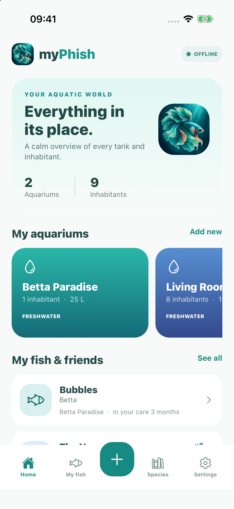
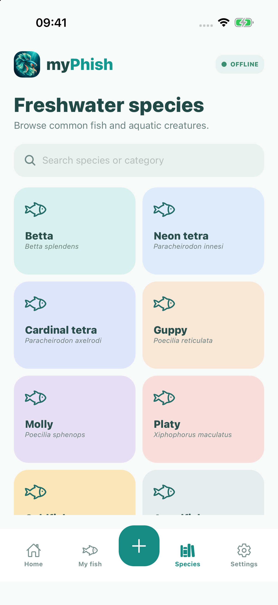
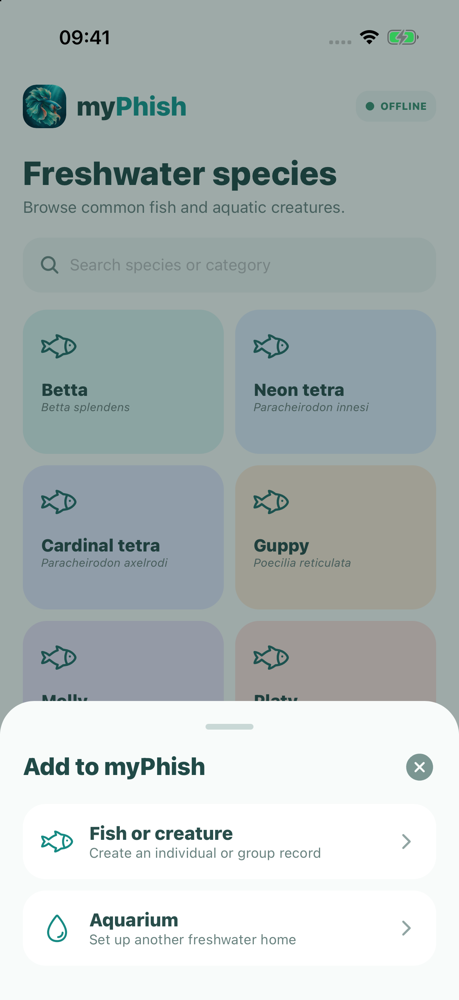

# myPhish

A calm, offline-first aquarium companion for iOS and Android. Track freshwater aquariums, individual fish or groups, care details, and transfers between tanks.

## What it does

- Create and manage freshwater aquariums with volume and resident counts.
- Record fish, groups, aquatic creatures, species, size, dates, store details, and notes.
- Browse a built-in freshwater species gallery or add a custom species.
- Open a fish record to review its details and move it to another aquarium.
- Save records locally on the device with AsyncStorage; no account or cloud sync is required.

## Screenshots

<p align="center">
  
  
  
</p>

## Run locally

Requirements: Node.js/npm, Expo CLI through the project script, and Expo Go or a native simulator. A Mac with Xcode is needed for a local iOS simulator build; Android Studio and its SDK are needed for an Android emulator build.

```bash
npm install
npm start
```

Then choose a device in the Expo developer tools or use one of the platform commands:

```bash
npm run ios       # iOS simulator (macOS with Xcode)
npm run android   # Android emulator/device with Android SDK
npm run web       # browser preview
npm run typecheck # TypeScript type check
```

For a physical device, install Expo Go and scan the QR code shown by `npm start`. Camera/device permissions are requested only when a feature needs them.

## Privacy and data

The app stores aquarium records on the current device. This version does not provide accounts, cloud sync, or an export/backup flow. Uninstalling the app or clearing its data may remove saved records, so keep that limitation in mind while using it.

## Built with

Expo, React Native, TypeScript, AsyncStorage, Expo Vector Icons, and Linear Gradient.
