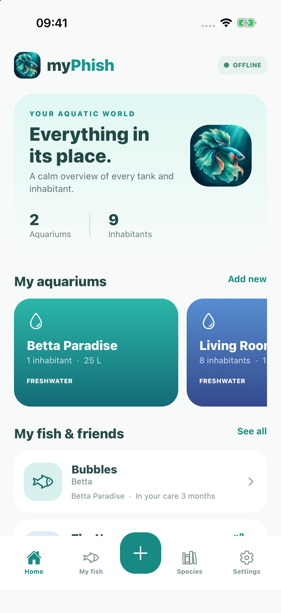
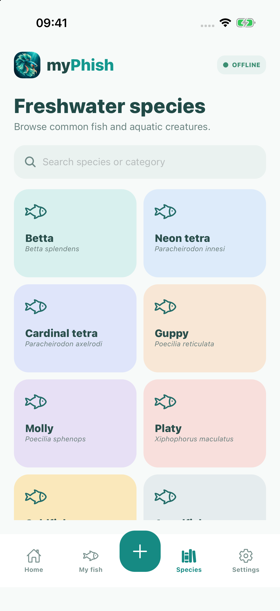
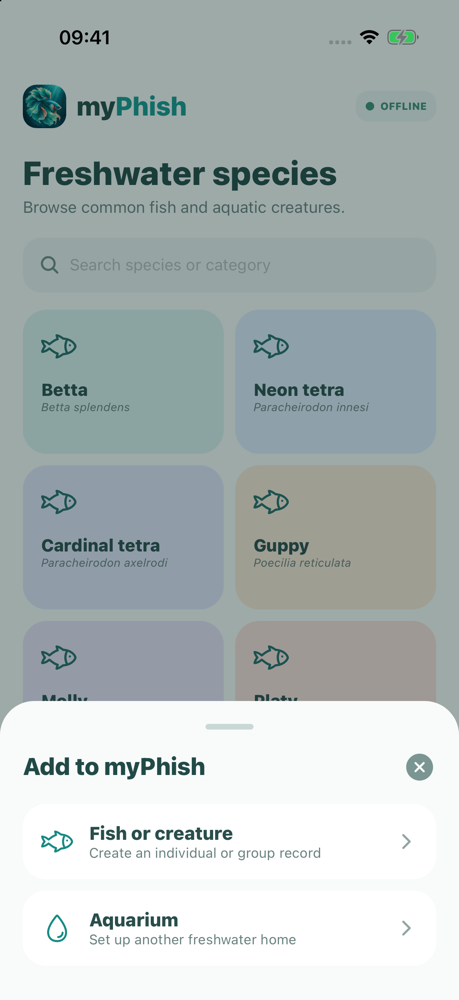

# myPhish

A calm, offline-first aquarium companion for iOS and Android. Track freshwater aquariums, individual fish or groups, age, time in care, size, store details, notes, and aquarium transfers.

## Screenshots

<p align="center">
  
  
  
</p>

## Run locally

```bash
npm install
npm run ios
```

Built with Expo, React Native, TypeScript, and local device storage.
